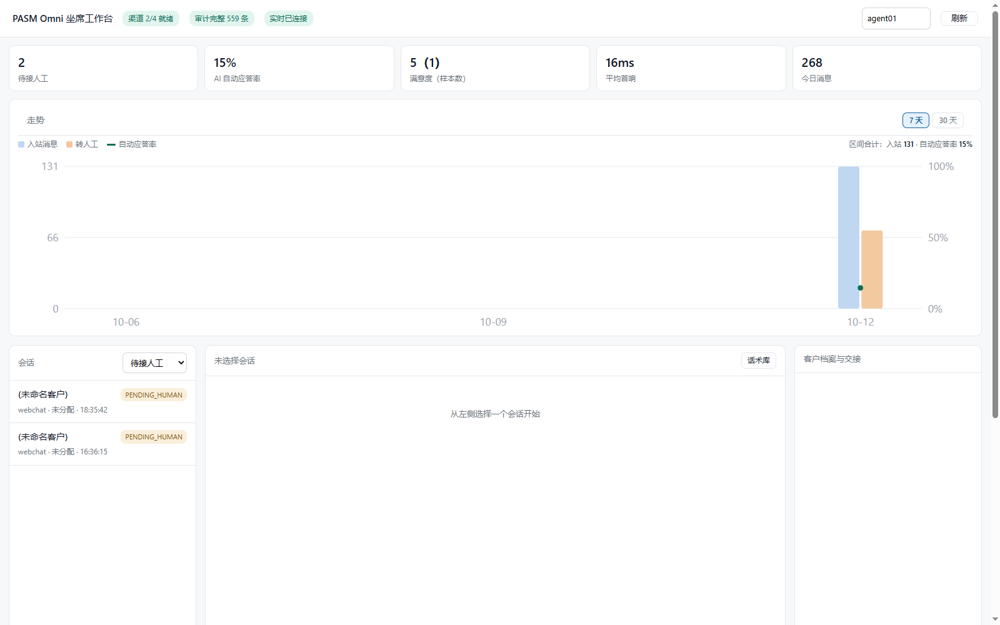
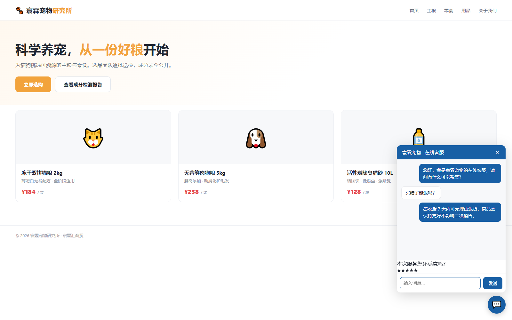

# PASM Omni · 霖通

> **外接式客户系统内核** —— 把 AI 客服能力「插」到你现有的业务上。
> 渠道即插即用，**答不上来就转人工**。

[](#)
[](#)
[](#)

---

## 这是什么

PASM Omni（霖通）不是一个要你「换掉现有客服系统」的 SaaS，而是一层**可以外接到任何业务上的客户系统内核**：

- 你原有的站点、店铺、客服流程**都不用动**，只把 AI 能力挂上去
- 一行 `<script>` 嵌入网页挂件，或走 webhook 对接订单与消息
- 数据全部留在**你自己的服务器**上（单文件 SQLite，部署即备份）

---

## 界面预览

以下均为**实际运行的界面截图**。

| 坐席工作台 | 访客挂件 |
| --- | --- |
|  |  |

---

## 七层能力

| 层 | 能力 |
| --- | --- |
| **渠道层** | 网页挂件 / Email / Telegram / 企业微信；外接渠道不限（继承注册 / 第三方包 / 通用外接口） |
| **会话层** | 统一收件箱、抢单、坐席交接摘要、内部备注 |
| **大脑层** | 可插拔：默认**抽取式**（直接引用知识库原文，结构上不可能幻觉）；可选接入 PASM 认知引擎 |
| **资产层** | SCRM 客户档案、自动标签规则、客户分层、访客轨迹时间线 |
| **营销层** | 话术库、服务评价（CSAT）、分流链接 |
| **数据层** | 实时看板、经营报表、订单统计 |
| **治理层** | 审计 hash 链、角色权限（viewer / agent / admin）、群发合规闸门 |

### 两点值得单独说

**① 反幻觉闸门：答不上来就转人工。**
默认大脑不做「生成」，只做**抽取 + 检索面判定**——命中知识库原文才答复，否则老老实实转人工。
测过才知道有多重要：抽取式应答在结构上**不可能编造**，这是客服场景最安全的形态。

**② 订单打通：让 AI 导购能查到真实订单。**
支持 **Shopify**、**WooCommerce（WordPress）** 与**通用 REST**（含字段别名，自建站也能接）三路接入，
webhook 全部 HMAC 验签；订单按「平台 + 单号」幂等，迟到的旧事件不会把已发货打回已付款。
访客问「我的订单到哪了」，秒回**真实状态与物流**（事实驱动，不生成），并且**带归属校验**——别人的单号查不到。

**③ MCP 原生。**
整个系统以 **30 个 MCP 工具**经 stdio 暴露，Claude Desktop / Cursor / WorkBuddy 等任意支持 MCP 的
AI 客户端可以直接调用它——不只是「有个聊天窗口」，而是让 AI 真正操作你的客户系统。

---

## 为什么是「零依赖 + 私有化」

| | |
| --- | --- |
| **零第三方依赖** | 纯 Python 标准库实现（sqlite3 / http.server / hashlib / json），Python 3.11+ 即可运行 |
| **单文件数据库** | SQLite 单文件，复制即备份，迁移即拷文件 |
| **私有化部署** | 装到你自己的服务器，数据不出内网 |
| **断网可用** | 默认大脑不依赖任何外部大模型服务 |

---

## 快速体验

访问官网静态站（首页即为产品介绍与界面预览）：

```
index.html          —— 首页（含界面预览）
products.html       —— 功能矩阵（逐项能力对照）
solutions.html      —— 独立站智能导购方案
ai-agents.html      —— AI 员工与大脑层
pricing.html        —— 价格方案
resources.html      —— 接口与集成资源
promotion.html      —— 推广合作
```

也可以直接看 `docs/` 下的说明：

- [功能介绍](docs/功能介绍.md)
- [接入指南](docs/接入指南.md)
- [常见问题](docs/FAQ.md)

---

## 价格

| 版本 | 价格 | 适合 |
| --- | --- | --- |
| **免费版** | ¥0（自托管） | 个人 / 小团队先跑起来验证效果 |
| **团队版** | ¥2,980 / 年 | 成长型客服团队（≤5 坐席） |
| **企业版** | ¥9,800 / 年 | 成熟企业 / 多渠道 / 不限坐席 |
| **定制版** | 面议 | 规模化业务 / 特殊场景 |

详细对照见 [价格方案](pricing.html)。

---

## 关于源码

本仓库为**产品展示与技术说明**用途，包含官网、界面截图与功能文档。

**产品源码不在此公开**。如需试用、私有化部署或源码授权，请通过下方方式联系。

---

## 联系

| 平台 | 地址 |
| --- | --- |
| 官网 | <https://arronjack.github.io/pasm-omni/> |
| GitHub | <https://github.com/arronJack/pasm-omni> |
| Gitee | <https://gitee.com/arronzheng/pasm-omni> |
| GitCode | <https://gitcode.com/arronzheng/pasm-omni> |
| 邮箱 | 625955122@qq.com |

---

<sub>© 2026 PASM 生态 · 保留所有权利。本仓库内容（含站点、截图、文档）可自由传播与引用，请注明来源。</sub>
